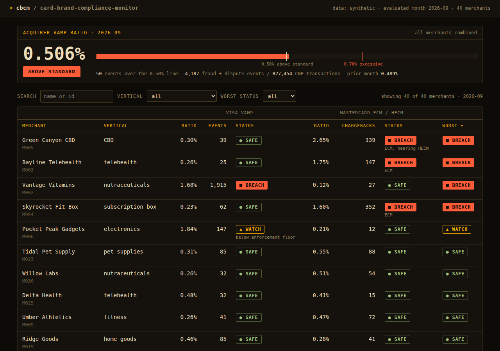

# Card Brand Compliance Monitor (VAMP + ECM)

A local web tool that shows whether merchants in an acquirer's book are close to tripping the Visa Acquirer Monitoring Program (VAMP) or Mastercard's Excessive Chargeback Program (ECM/HECM). It flags each merchant as Safe, Watch, or Breach for each program, tracks the acquirer's own book-level VAMP ratio, and gives a what-if for how many fewer disputes a merchant needs next month to get under each line.

It is a portfolio project for risk operations, fraud investigation, and risk strategy roles. All data is synthetic.

## Screenshot



*(Placeholder image: replace `docs/screenshot.png` with a fresh capture after any UI change.)*

## Run it

Python 3.10 or later.

```bash
python3 -m venv .venv
source .venv/bin/activate
pip install -r requirements.txt
python -m app
```

Open [http://127.0.0.1:8000](http://127.0.0.1:8000). The seeded data file is created automatically on first run. To regenerate it by hand: `python scripts/generate_data.py`. To run the tests: `pytest`.

`uvicorn app.main:app --reload` also works if you prefer it.

## Screens

1. **Portfolio.** A banner shows the acquirer-wide VAMP ratio against the 0.50% (Above Standard) and 0.70% (Excessive) lines. Below it, every merchant appears with Visa status, Mastercard status, and worst status. The table sorts by any column and filters by name, vertical, and worst status.
2. **Merchant detail.** Six-month trend charts for the Visa ratio and the Mastercard ratio with the threshold lines drawn, the what-if output, and a month-by-month table.

## Rules implemented

All thresholds live in `app/config.py`. The rules are pure functions in `app/rules.py` with unit tests in `tests/`.

**Visa VAMP (merchant).** Ratio = (TC40 fraud + TC15 disputes) / settled card-not-present transactions. A merchant is Excessive at a ratio of 1.50% or more, but only enforceable when combined events reach 1,500 in the month. The ratio is always shown; if it is at or above 1.50% but events are under the floor, the row is labeled "below enforcement floor" and shown as Watch.

**Visa VAMP (acquirer).** Ratio = all merchants' events / all merchants' CNP transactions. Above Standard at 0.50% or more, Excessive at 0.70% or more.

**Mastercard ECM / HECM.** Ratio = this month's chargebacks / the PRIOR month's sales count. ECM needs at least 100 chargebacks and a ratio of 1.50% or more. HECM needs at least 300 and 3.00% or more. Both conditions are required for each. A merchant leaves the ECM program only after 3 consecutive months under the ECM thresholds, so a single good month leaves it marked Breach.

**Statuses.** Safe, Watch (within about 80% of a line), or Breach, per program, plus the worst of the two per merchant.

**What-if.** Fewer events next month at the same volume to get under each line. Visa enforcement needs both the ratio and the 1,500-event floor, so the tool reports whichever route needs fewer cuts. Mastercard what-ifs measure next month's chargebacks against this month's sales, matching the prior-month rule.

## The synthetic data

About 40 merchants with monthly rollups, generated by a seeded script. Seven months are created: the first is a baseline that only supplies the "prior month sales" denominator, so six months are evaluated. Six merchants are planted by name:

| ID | Merchant | Scenario |
| --- | --- | --- |
| M001 | Juniper Home Goods | Clean, for contrast |
| M002 | Vantage Vitamins | Breaches Visa VAMP only |
| M003 | Bayline Telehealth | Breaches Mastercard ECM only; Visa events far below the floor |
| M004 | Skyrocket Fit Box | Fast growth inflates the Mastercard ratio (prior-month denominator) |
| M005 | Green Canyon CBD | Trending toward HECM (300+ chargebacks, ratio nearing 3%) |
| M006 | Pocket Peak Gadgets | Small merchant that pushes the book over 0.50% |

The book sits just under 0.50% without M006 (0.493%) and just over with it (0.506%).

## Sources and assumptions

- All data is synthetic. No real merchant, cardholder, or acquirer data is used.
- Thresholds come from public acquirer and processor documentation. Mastercard's own manuals are not public, so the Mastercard rules are an assumption based on those secondary sources and may differ from current program rules.
- Program rules and thresholds change. Treat the values in `app/config.py` as a documented starting point, not authority.
- The tool has no access to any card network system and calls no external APIs.
- Note: a merchant terminated for excessive chargebacks or fraud can be added to the MATCH list, which affects future onboarding elsewhere. MATCH listing is described here for context and is not modeled.

## Not built (v2 ideas)

- MATCH onboarding screen
- Forecasting
- Fee and fine estimates
- Enumeration ratio

## Layout

```
app/        FastAPI app, config, pure rules, analysis, static UI
scripts/    seeded synthetic data generator
data/       generated CSV and manifest
tests/      rule, data, and API tests
docs/       screenshot
```
